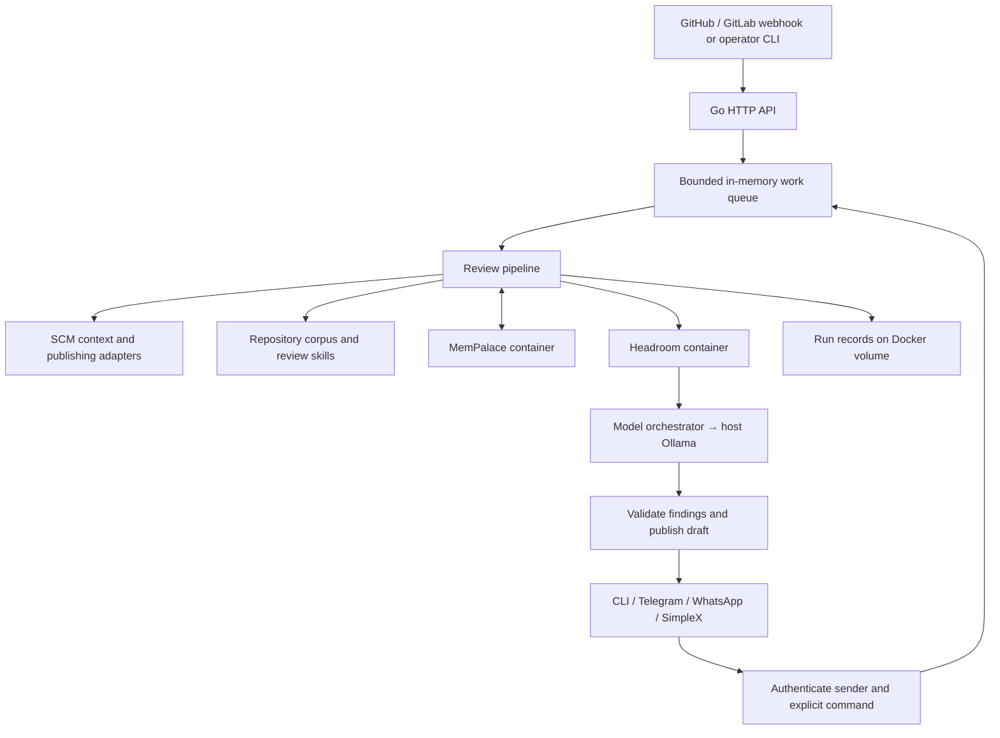

# Local Alpha

This guide describes the implemented review server, not completion of the
adaptive-engine roadmap. The local deployment uses a separate Compose project,
`7review-alpha`, and persists its own run, cache and memory volumes.

## What Runs



The Go image is non-root with a read-only root filesystem. Headroom and
MemPalace are separate Python services reachable only on the Compose network.
The repository corpus and editable profile/model configuration are mounted
read-only. The API binds to `127.0.0.1:18087`; it is not a browser dashboard.
The operator interface is the CLI/TUI.

Final publication requires explicit approval. Approval also writes approved
memory. This existing workflow is distinct from the target's independent
publication, investigation and memory-activation contracts.

The separate `7review ci review` entry point does not start this stack:
it evaluates frozen repository input and verified quality artifacts, then
exports reports and gate results without publishing to SCM.

## Start And Inspect

Docker Compose must support `!override` (2.24.4 or newer).
Use the repository's existing `.env`, or run `make setup` first. Never commit it.
SCM and operator credentials are required by the current server startup contract.

```sh
make local-up
make local-status
make local-tui
make local-logs
```

Ollama must be reachable from Docker at `host.docker.internal:11434`.
The local override selects installed models:

- Review: `deepseek-coder-v2:16b`, override with `ALPHA_REVIEW_MODEL`.
- Formatting/chat: `qwen2.5-coder-7b-16k:latest`, override with `ALPHA_SMALL_MODEL`.
- Embeddings follow the existing profile/environment configuration.

Set `ALPHA_HTTP_PORT` to choose another loopback port. The override forces
`manual_first`; bringing up the stack does not request a review.
Edit the mounted profile to enable a channel deliberately. See
[channel setup](integrations.md#approval-channels).
Inside a container, `127.0.0.1` refers to that container. SimpleX on the host
needs a reachable secured WebSocket proxy; it is not bundled into this image.

`make local-stop` stops this project and preserves volumes.
Do not delete volumes to solve startup issues: they hold run history and memory.

## Behavior Checks Before Operator Testing

| Given / When / Then | Evidence |
| --- | --- |
| Valid GitHub/GitLab request, review completes, draft is persisted; revision/suppression and explicit final approval work | `TestE2EGitHubReviewLifecycle`, `TestE2EGitLabReviewLifecycle` with fake SCM/model/memory |
| Wrong secret or sender, provider callback arrives, no action is queued | Channel inbound/provider authorization tests |
| Same provider callback arrives twice, one action is queued | `TestChannelDelivery_DuplicateCallbackQueuesOnce` |
| Queue is full, callback fails, retry after capacity returns queues the action | `TestChannelDelivery_QueueFullCanRetry` |
| Ambiguous command arrives, publication is not authorized | `TestCommands_RejectAmbiguousApproval` |
| SimpleX sends, receipt is returned only after correlated acknowledgement | `TestSimpleX_SendAcknowledgement` |
| SimpleX listener receives an authorized revision, the shared queue receives work | `TestSimpleX_ListenerRoutesAuthorizedRevision` |
| Sidecar is unavailable, readiness reports failure | Runtime readiness tests |
| MemPalace init creates config without storage, repeated health probes do not reinitialize it | `test_health_initializes_workspace_once` |
| Memory work holds the write lock, initialized health remains responsive | `test_initialized_health_does_not_wait_for_memory_write` |

Run `make verify` for formatting, Python bridge tests, Go tests and Compose
validation. Run `go test -race ./agent/app ./agent/channel` for the changed
concurrent paths. These tests do not establish model accuracy or live provider
delivery.

## First Operator Journey

1. Verify container health, authenticated status, model reachability and sidecar
   reduce/write/recall contracts.
2. Select a disposable PR/MR and confirm the SCM credential has the intended access.
3. Request exactly one review. Inspect the draft, evidence and errors in the CLI.
4. Revise or suppress a finding, then approve the intended final report.
5. Confirm final publication and memory writeback.
6. Repeat using one enabled channel before qualifying the other channels.

## Known Alpha Limits

Readiness checks configuration and sidecars; it does not authenticate the SCM
account, prove model inference or check channel delivery. Live tests must cover
those boundaries separately.

The bounded work queue and delivery deduplication are in-process. Run files
persist across restarts, but accepted queued work and deduplication claims do not.
Do not interrupt an active review or run multiple server instances for this alpha.
Separate operator commands are not a durable transaction with provider publication;
uncertain publication after an external failure requires inspection before retry.

The durable attempt ledger, revision-fenced commands, resumable scheduler, native
CI publication and governed memory lifecycle remain roadmap work. Testing this
baseline is not acceptance of those unfinished contracts.

## Local Verification On 2026-10-28

Executed against the separate local Docker stack:

- All three containers healthy; API bound only to `127.0.0.1:18087`.
- Authenticated CLI status and TUI display `READY`; interactive `/status` works.
- Unauthenticated readiness request returns `401`; liveness returns `200`.
- Real Headroom reduction and MemPalace write/semantic recall contract smoke passes.
- Configured Ollama models are installed and reachable from the model-connected
  container; a small formatter inference completes successfully.
- `make verify` and app race tests pass.

No real PR/MR was reviewed or published in this verification. Reasoner output
quality, SCM credential validity and live channel callbacks are still unqualified.
